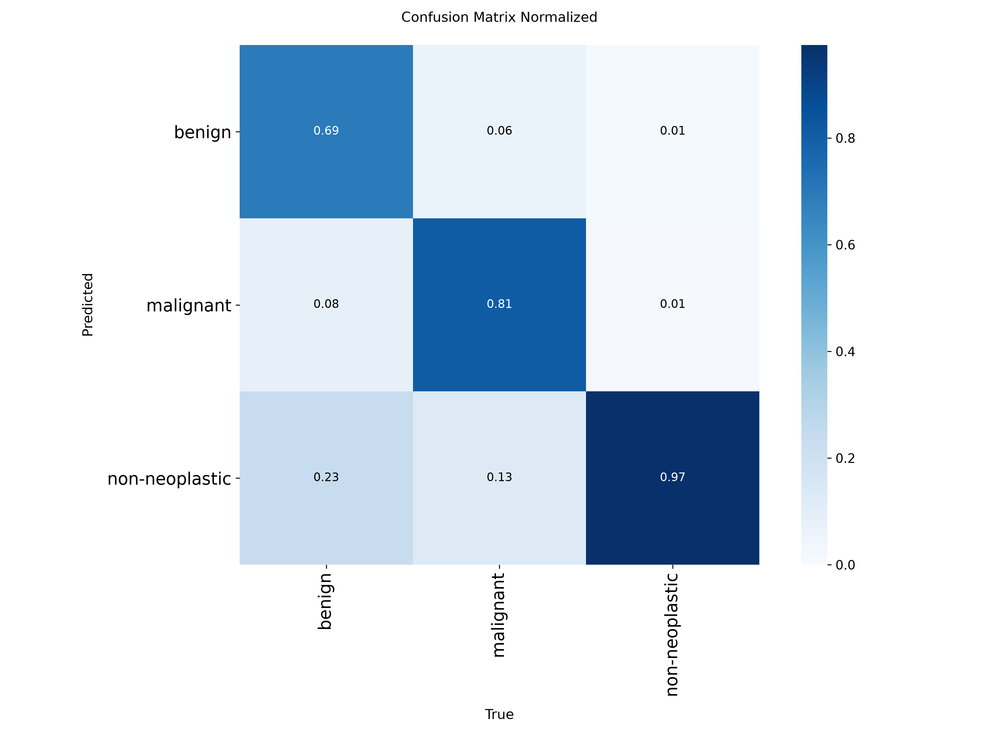
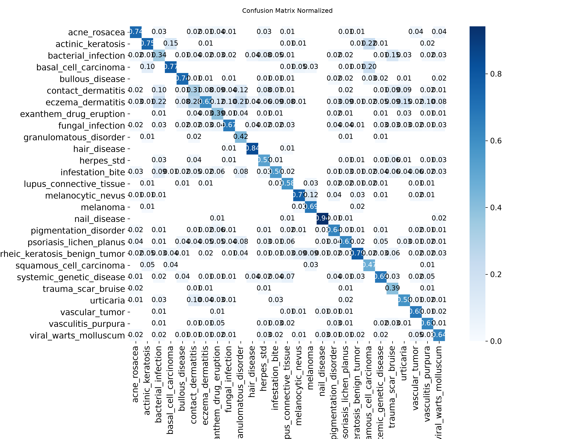
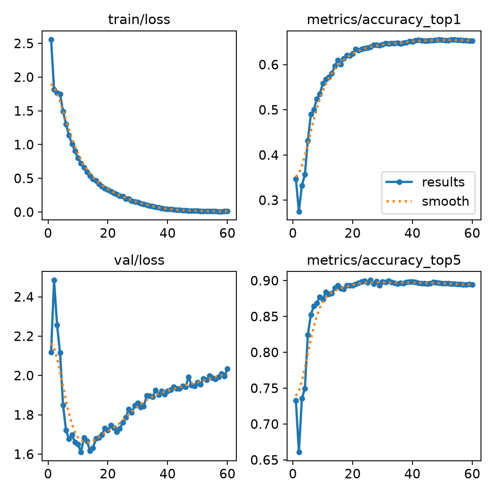
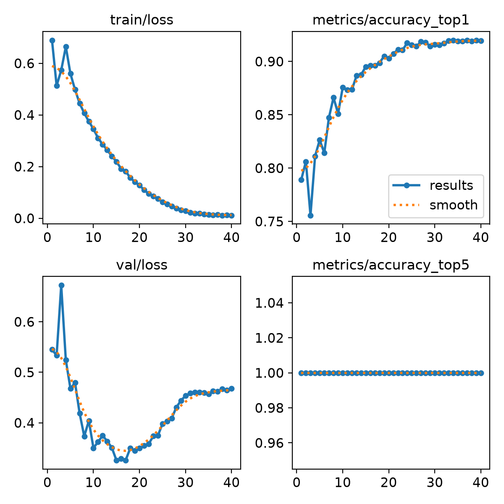

# Skin Disease & Lesion Classification with YOLO11

Two-model YOLO11 classifier for clinical and smartphone skin photos.

- **Model A — disease:** names the condition across 27 classes.
- **Model B — malignancy:** classifies the image as `benign`, `malignant` or `non-neoplastic`.

Both models see the same photo. A cancer flag is raised if Model B says `malignant` **or**
Model A's predicted disease is a malignant one. The OR is deliberate: a missed cancer costs more
than a false alarm.

> **Not a medical device.** Research project only. Do not use it to diagnose anyone.

## Results (held-out test set)

| | Model A · disease | Model B · malignancy |
|---|---|---|
| Classes | 27 | 3 |
| Test images | 4,120 | 4,445 |
| Top-1 accuracy | **63.6%** | **92.0%** |
| Macro-F1 | 0.628 | 0.845 |
| Malignant recall | – | **0.809** |

The test split shares no patient or lesion with train or val, and near-duplicates were removed
before splitting. Per-class figures are in `runs/interim_metrics_2026-09-20.json`.

### Model B — malignancy, per class

| Class | Precision | Recall | F1 | Test images |
|---|---|---|---|---|
| non-neoplastic | 0.945 | 0.974 | 0.959 | 3,349 |
| malignant | 0.860 | **0.809** | 0.834 | 593 |
| benign | 0.802 | 0.692 | 0.743 | 503 |

Of the malignant test images, 81% are predicted malignant, 13% non-neoplastic and 6% benign.

<p align="center">
  
</p>

### Model A — disease, best and worst classes

| Best classes | F1 | | Worst classes | F1 |
|---|---|---|---|---|
| nail disease | 0.924 | | contact dermatitis | 0.295 |
| hair disease | 0.840 | | bacterial infection | 0.358 |
| seborrheic keratosis / benign tumor | 0.783 | | trauma / scar / bruise | 0.433 |
| basal cell carcinoma | 0.777 | | exanthem / drug eruption | 0.436 |
| acne / rosacea | 0.740 | | granulomatous disorder | 0.465 |

Errors follow visual similarity, not sample count. Contact dermatitis, eczema and bacterial
infection look alike in photos, so the model confuses them even though each has plenty of images.

**Melanoma:** 22 of 32 test images correct (recall 0.688). Of the 10 misses, 7 went to benign
classes (4 nevus, 3 seborrheic keratosis) and 2 to other malignant classes, which the OR rule still
flags as cancer.

<p align="center">
  
</p>

### Training curves

| Model A · disease | Model B · malignancy |
|---|---|
|  |  |

Best validation top-1: 65.5% at epoch 49 (A) and 92.0% at epoch 34 (B). Validation loss is lowest
around epoch 11 (A) and 15 (B) and then rises while accuracy still improves slightly, a sign of
over-confidence worth addressing with calibration or fewer epochs.

The full write-up, with charts and sample images, is in
[`doc/Skin_Lesion_YOLO11_Project_Report.pptx`](doc/Skin_Lesion_YOLO11_Project_Report.pptx).

## Data

| Source | Raw images | Kept |
|---|---|---|
| [DermNet](https://huggingface.co/datasets/exper1ment/dermnet) | 19,559 | 17,829 |
| [SCIN (Google)](https://github.com/google-research-datasets/scin) | 10,364 | 5,665 |
| [Fitzpatrick17k](https://github.com/mattgroh/fitzpatrick17k) (reachable URLs only) | 3,887 | 3,876 |
| [PAD-UFES-20](https://data.mendeley.com/datasets/zr7vgbcyr2/1) | 2,298 | 2,270 |
| **Total** | **36,108** | **29,640** |

The `data/` folder (images, manifests, label map) is **not** included in this repository. Each
source has its own license; download it from the links above and the pipeline scripts rebuild
everything under `data/`. Dermoscopy datasets (ISIC, HAM10000) are left out on purpose, so the model
cannot learn camera type instead of disease.

## Pipeline

| Stage | Script | What it does |
|---|---|---|
| 0 | `scripts/00a–00c_fetch_*.py` | Download DermNet, SCIN and Fitzpatrick17k (hash-verified, resume-safe). PAD-UFES-20 is downloaded manually |
| 1 | `scripts/01_manifest.py` | One row per image; fails if any source is incomplete |
| 2 | `scripts/02a–02c_*.py` | Hand-sort mixed DermNet folder 11, then map 330 raw labels to 27 diseases + malignancy |
| 3 | `scripts/03_dedup.py` | pHash + LSH + union-find; removes 1,558 near-duplicates |
| 4 | `scripts/04_split.py` | Filters, resizes to 512 px, StratifiedGroupKFold 70/15/15 grouped by patient |
| 5 | `scripts/05_layout.py` | Builds the YOLO ImageFolder trees with hard links |
| 6 | `scripts/06_train.py` | Fine-tunes `yolo11s-cls.pt` (320 px, batch 64, cosine LR, RandAugment off) |

Design reasoning is in [`PIPELINE_PLAN.md`](PIPELINE_PLAN.md), the operational summary in
[`PROJECT_OVERVIEW.md`](PROJECT_OVERVIEW.md), and data details in
[`doc/DATA_SOURCES.md`](doc/DATA_SOURCES.md).

## Reproduce

```bash
uv venv skin --python 3.12
uv pip install --python skin/Scripts/python.exe --torch-backend=auto -r requirements-skin.txt

python scripts/00a_fetch_dermnet.py
python scripts/00b_fetch_scin.py
python scripts/00c_fetch_fitz_atlas.py
# place PAD-UFES-20 in data/raw/pad_ufes_20/
python scripts/01_manifest.py
python scripts/02c_build_label_map.py
python scripts/03_dedup.py
python scripts/04_split.py
python scripts/05_layout.py
python scripts/06_train.py --task disease
python scripts/06_train.py --task malignancy
```

Trained on an RTX 4060 Laptop GPU (8 GB): 3 h 45 m for Model A, 2 h 15 m for Model B.

## Known limitations

- Malignant recall is 0.81 for Model B alone, so about 1 in 5 cancers is missed before the OR rule applies.
- Melanoma has only 32 test images (recall 0.688), so treat that figure as directional.
- Performance by skin type (Fitzpatrick 5–6 is ~15% of labelled images) has not been measured yet.
- Decision thresholds are not calibrated yet. `07_eval.py` and the live camera app are still to do.

## Weights

Trained weights are not in the repository. They are derived from Ultralytics YOLO11
(AGPL-3.0) and are available on request for research use.

## License

No license is granted. All rights reserved. © 2026 Faisal Bin Zaman Zihan.
Contact the author for permission to use this work.
